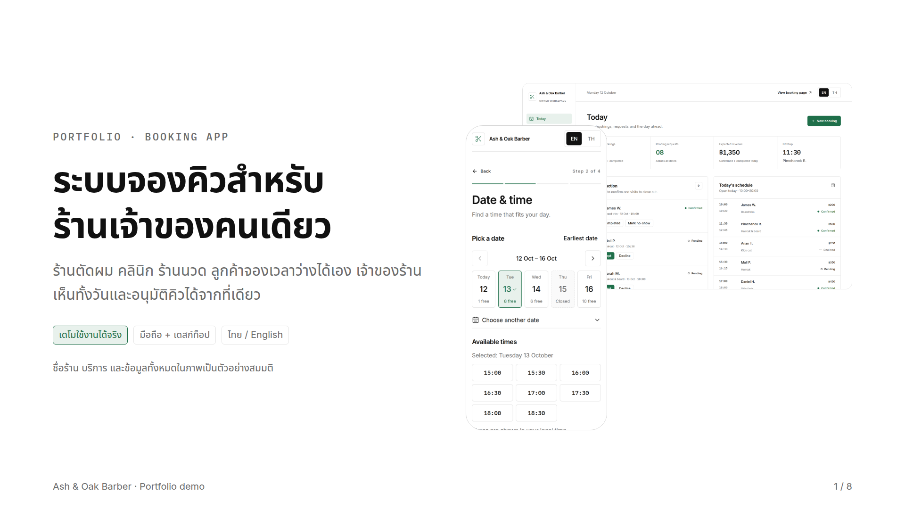
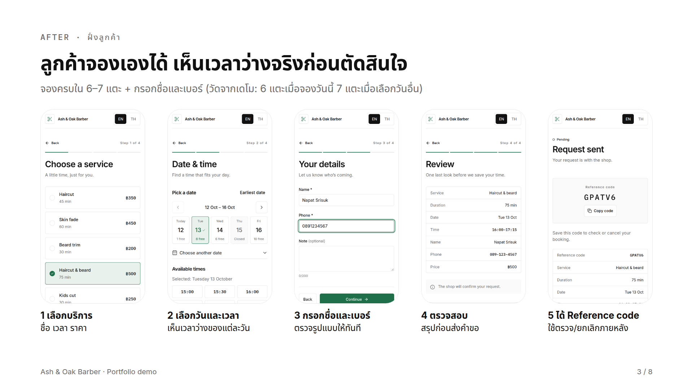
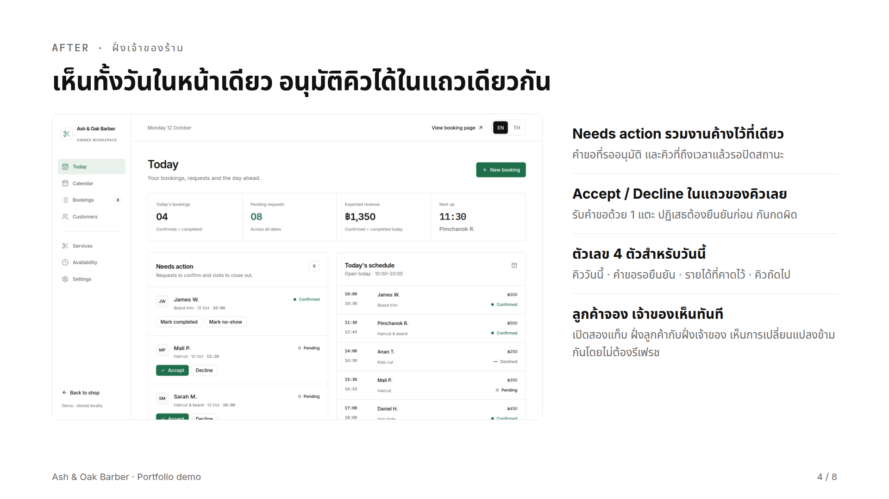
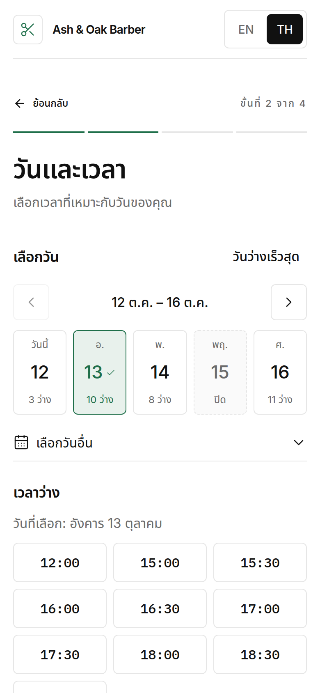
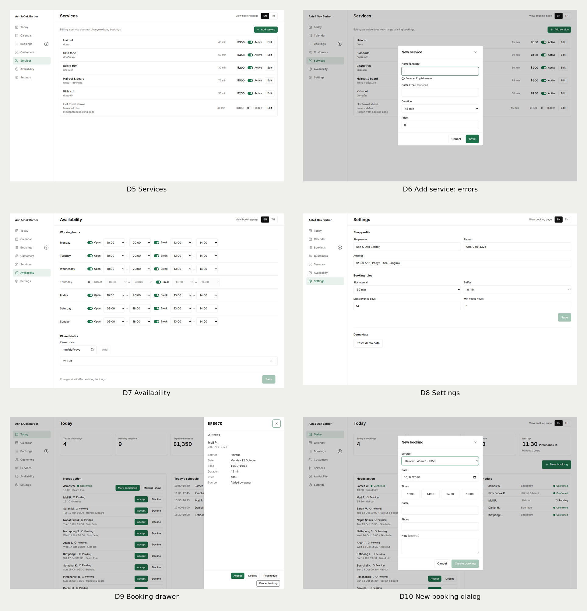

# Ash & Oak Barber — ระบบจองคิวร้านตัดผม

เดโมเว็บแอปสำหรับร้านที่เจ้าของคนเดียว: ลูกค้าเลือกบริการและเวลาว่างที่ยังจริงอยู่ แล้วส่งคำขอจองเอง ส่วนเจ้าของร้านเห็นทั้งวันในหน้าเดียว อนุมัติคำขอ บันทึกคิว walk-in และปิดงานได้โดยไม่ต้องมี backend

ทั้งสองฝั่งอยู่ในแอปเดียวกัน ไม่มี login — หน้าแรกให้เลือกว่าจะเข้าเป็นลูกค้าหรือเจ้าของร้าน ข้อมูลเก็บใน `localStorage` ของเบราว์เซอร์ เปิดสองแท็บ (ลูกค้า/เจ้าของ) แล้วเห็นการเปลี่ยนแปลงข้ามกันทันที



## สารบัญ

- [ภาพหน้าจอ](#ภาพหน้าจอ)
- [ฟีเจอร์](#ฟีเจอร์)
- [กฎการจองที่ระบบบังคับ](#กฎการจองที่ระบบบังคับ)
- [เทคโนโลยี](#เทคโนโลยี)
- [เริ่มใช้งาน](#เริ่มใช้งาน)
- [โครงสร้างโปรเจกต์](#โครงสร้างโปรเจกต์)
- [ข้อมูลเดโม](#ข้อมูลเดโม)
- [ตรวจสอบคุณภาพ](#ตรวจสอบคุณภาพ)
- [เอกสาร](#เอกสาร)
- [ข้อจำกัดของเดโม](#ข้อจำกัดของเดโม)

## ภาพหน้าจอ

| ฝั่งลูกค้า — เลือกวันและเวลา | ฝั่งเจ้าของร้าน — Today |
|---|---|
|  |  |

| มือถือ ภาษาไทย | งานจัดการ Services / Availability / Settings |
|---|---|
|  |  |

วิดีโอเดโม: [`docs/portfolio/demo-flow.mp4`](docs/portfolio/demo-flow.mp4) (36 วินาที — ลูกค้าจองบนมือถือ → เจ้าของกดรับ → เวลาที่ถูกจองหายจากตัวเลือก) และ [`docs/portfolio/promo.mp4`](docs/portfolio/promo.mp4) (96 วินาที พร้อมสไลด์เล่าเรื่อง)

## ฟีเจอร์

### ฝั่งลูกค้า (mobile-first)

- จอง 4 ขั้นตอน: เลือก Service → วัน/เวลา → ข้อมูลติดต่อ → ตรวจทานก่อนส่ง พร้อมตัวบอก "Step n of 4"
- แสดงเฉพาะเวลาที่จองได้จริง: คำนวณจาก duration ของ Service, เวลาเปิด-ปิด, break, buffer, ระยะเวลาแจ้งล่วงหน้าขั้นต่ำ และวันที่ปิดร้าน
- วันปิดร้าน/วันเต็ม แสดงป้าย `Closed` / `Full` ไม่ใช่ซ่อนเฉย ๆ (ไม่พึ่งสีอย่างเดียว)
- ตรวจชื่อ/เบอร์โทร/โน้ตที่หน้าแรกที่ผิด พร้อมโฟกัสไปยังช่องนั้น
- ได้ Reference code 6 ตัว ไว้ตรวจสถานะและยกเลิกภายหลังด้วย code + เบอร์โทร
- สถานะอัปเดตเองเมื่อเจ้าของกดรับ/ปฏิเสธในอีกแท็บ — ไม่ต้อง refresh
- ยกเลิกได้เองจนถึงเวลาที่กำหนด ถ้าเลยกำหนดแล้วจะบอกเบอร์โทรร้านให้โทรแทน

### ฝั่งเจ้าของร้าน (desktop-first)

| หน้า | ทำอะไรได้ |
|---|---|
| Today | ตัวเลขวันนี้ 4 ตัว (คิววันนี้, คำขอรออนุมัติ, รายได้คาดการณ์, คิวถัดไป), Needs action, ตารางคิวทั้งวัน |
| Calendar | ปฏิทินสัปดาห์ จันทร์–อาทิตย์ เลื่อนสัปดาห์ก่อน/ถัดไป/วันนี้ คลิกบล็อกเพื่อเปิดดีเทล คลิกช่องว่างเพื่อสร้างคิว |
| Bookings | รายการทั้งหมด แยก Upcoming/Past/All กรองตามสถานะ ค้นด้วยชื่อ เบอร์โทร หรือ Reference code |
| Customers | ลูกค้าที่ derive จากประวัติการจอง (จำนวนครั้ง, no-show, ยอดใช้จ่าย, ครั้งล่าสุด, คิวกัดไป) กดขยายดูประวัติ |
| Services | เพิ่ม/แก้ไขบริการ (ชื่อ EN บังคับ, ชื่อ TH ไม่บังคับ, ระยะเวลา, ราคา) ซ่อนจากหน้าจองได้โดยไม่ลบ |
| Availability | เวลาเปิด-ปิดและ break ของทั้ง 7 วัน พร้อมรายการวันที่ปิดร้าน |
| Settings | ข้อมูลร้าน, กฎการจอง (slot interval, buffer, จองล่วงหน้าได้กี่วัน, แจ้งล่วงหน้ากี่ชั่วโมง), รีเซ็ตข้อมูลเดโม |

- อนุมัติ/ปฏิเสธคำขอจาก Needs action ได้ในแถวเดียว และปิดงานเป็น Completed / No-show ได้หลังเวลาเริ่มเท่านั้น
- Walk-in booking ที่เจ้าของสร้างจะ Confirmed ทันที และไม่ติดข้อจำกัดเรื่องแจ้งล่วงหน้า/จองล่วงหน้า แต่ยังกันการทับคิว
- Reschedule ผ่าน dialog ที่เสนอเฉพาะเวลาที่ว่าง (นับเวลาของคิวนั้นเองว่าว่าง) และคงสถานะเดิมไว้
- ดีเทลการจองเปิดเป็น drawer อันเดียวกันทุกหน้า ผ่าน query parameter

### ภาษาและการออกแบบ

- สลับ EN/TH ได้ทุกหน้า และจำภาษาที่เลือกไว้หลัง refresh (dictionary 283 คีย์ต่อภาษา ตรวจความครบที่ compile time)
- ตัวเลข วันที่ และราคา (฿) แสดงตามภาษา; เวลาเป็น 24 ชั่วโมง `HH:mm` ทุกจุด
- สไตล์ minimalism ขาว-ดำ ตัวอักษร ink เส้น 1px accent เขียวเดียว `#1F6F4A` ไม่มีเงา ยกเว้น dialog/drawer
- ฟอนต์ Inter + Noto Sans Thai (UI) และ IBM Plex Mono (เวลากับ Reference code ที่อ่านผิดไม่ได้)
- คีย์บอร์ดใช้ได้ทั้งหมด, focus ring มองเห็นเสมอ, dialog ปิดด้วย Esc, ข้อความ error อยู่ติดช่องและผูกด้วย `aria-describedby`

## กฎการจองที่ระบบบังคับ

สถานะการจอง 6 แบบ และทางเดินที่อนุญาต:

| สถานะ | เปลี่ยนไปได้ | ถือเวลาไว้ไหม |
|---|---|---|
| Pending | Confirmed, Declined, Cancelled | ใช่ |
| Confirmed | Completed, No-show, Cancelled | ใช่ |
| Completed | — | ใช่ |
| Declined / Cancelled / No-show | — | ไม่ (เวลากลับมาว่าง) |

- Customer ยกเลิกได้เฉพาะ Pending/Confirmed และเฉพาะเมื่อเวลาเริ่มยังไม่ใกล้กว่าที่กำหนดไว้ใน Settings
- Completed/No-show บันทึกได้ตั้งแต่เวลาเริ่มผ่านไปแล้วเท่านั้น
- Service ที่ถูกแก้ไขไม่กระทบการจองเก่า เพราะตอนจอง snapshot duration และราคาไว้แล้ว
- เบอร์โทรเก็บเป็นตัวเลขล้วน ตรวจรูปแบบ 10 หลักขึ้นต้นด้วย `0` และแสดงเป็น `081-234-5678`

## เทคโนโลยี

| ส่วน | ใช้ |
|---|---|
| UI | React 19, TypeScript, Vite, Tailwind CSS 4 |
| Routing | `react-router` แบบ hash (`HashRouter`) — วางบน static host ที่ไหนก็ได้ |
| วันที่ | `date-fns` (locale en/th) |
| ไอคอน/ฟอนต์ | `lucide-react`, `@fontsource` (Inter, Noto Sans Thai, IBM Plex Mono) |
| Test | Vitest (Node environment) |
| Lint | oxlint |

โครงสร้างแยก 3 ชั้น: `src/domain/` (ตรรกะล้วน ไม่มี React) → `src/store/` (state + persistence + mutation) → หน้าจอและ component ฝั่ง UI ตรรกะเรื่อง slot, สถานะ, Reference code และสถิติ อยู่ที่ domain ทั้งหมด จึงทดสอบได้โดยไม่ต้องเปิดเบราว์เซอร์

## เริ่มใช้งาน

ต้องมี Node.js `^20.19.0` หรือ `>=22.12.0` (ตาม Vite 8)

```bash
npm install
npm run dev        # dev server
npm run build      # tsc -b && vite build → dist/
npm run preview    # เสิร์ฟ dist/ ที่ build แล้ว
npm test           # vitest run
npm run lint       # oxlint
```

เปิดหน้าแรกแล้วเลือก **Book as customer** หรือ **Open owner dashboard** — ไม่ต้องมี account หรือ backend ใด ๆ

## โครงสร้างโปรเจกต์

```
src/
  domain/        ตรรกะล้วน: slots, booking transitions, stats, seed, time helpers (+ *.test.ts)
  store/         AppStore (localStorage + cross-tab sync), useNow
  pages/
    customer/    Landing, BookFlow (4 steps), BookDone, MyBooking, NotFound
    dashboard/   Today, Calendar, Bookings, Customers, Services, Availability, Settings
  components/    ui/ (Button, Form, DatePicker, TimeSelect, Overlay…), booking/ (drawer, dialogs)
  i18n/          dictionary EN/TH แยกตามหมวด
  layouts/       CustomerLayout, DashboardLayout
docs/
  design/        user flow, wireframes, screen states, design system + ภาพบอร์ด
  portfolio/     สไลด์ PDF วิดีโอ และภาพหน้าจอที่ใช้ใน README
barber-booking/  spec และ ticket ทั้ง 12 ฉบับที่ใช้สร้างแอปนี้
GLOSSARY.md      คำศัพท์ที่ใช้ทั้งโปรเจกต์ (Shop, Owner, Customer, Booking, Slot…)
```

## ข้อมูลเดโม

- Seed ถูกสร้างจาก "ตอนนี้" ทุกครั้ง: วันนี้เปิดร้านและมีคิวเต็มวัน มีคำขอ Pending ค้างอยู่ และมีคิวที่เลยเวลาเริ่มแล้วรอปิดงาน เพื่อให้ dashboard ดูมีงานทันที
- ข้อมูลคงอยู่หลัง refresh ที่คีย์ `bookingsaas.state.v1`; กด **Reset demo data** ใน Settings เพื่อกลับไปข้อมูลตัวอย่าง
- ชื่อร้าน บริการ ราคา และลูกค้าเป็นข้อมูลสมมติทั้งหมด ไม่มีข้อมูลของร้านจริง
- ตัวเลขที่วัดจากเดโมตอนอัดวิดีโอ (ไม่ใช่ผลลัพธ์ทางธุรกิจ): ลูกค้าจองครบ 6 แตะ (จองวันอื่น +1), เจ้าของกดรับคำขอ 1 แตะ, ชุดทดสอบ 19 ข้อผ่านทั้งหมด

## ตรวจสอบคุณภาพ

รันบนเครื่องที่เขียนโปรเจกต์นี้:

```bash
npx tsc -b        # ผ่าน ไม่มี error
npx vitest run    # 3 ไฟล์ 19 tests ผ่านทั้งหมด
npm run build     # ผ่าน (bundle ~426 kB / gzip ~124 kB)
npx oxlint        # 13 warnings (react-hooks exhaustive-deps / purity) ไม่มี error
```

ชุดทดสอบครอบคลุมเฉพาะ `src/domain/` (slot, transition, การยกเลิก, Reference code, เบอร์โทร, seed) ส่วน UI ตรวจด้วยการเปิดแอปจริงในเบราว์เซอร์ ทั้งคู่มือและหน้าจอที่ 390px/1440px

## เอกสาร

- [`GLOSSARY.md`](GLOSSARY.md) — คำศัพท์และคำที่ห้ามใช้ (เช่นใช้ "Booking" ไม่ใช่ "appointment")
- [`barber-booking/spec.md`](barber-booking/spec.md) — spec ต้นทาง: user stories, การตัดสินใจ, ขอบเขต
- [`barber-booking/issues/`](barber-booking/issues/) — ticket 12 ฉบับที่ลงมือทำตามลำดับ
- [`docs/design/`](docs/design/) — user flow, wireframes, screen states, design system
- [`docs/portfolio/guide.md`](docs/portfolio/guide.md) — ชุดนำเสนอ portfolio: ไฟล์ไหนใช้ทำอะไร ตัวเลขมาจากไหน

## ข้อจำกัดของเดโม

- ไม่มี backend, ฐานข้อมูล, login หรือ multi-shop — ข้อมูลอยู่ในเบราว์เซอร์เครื่องนั้นเครื่องเดียว
- ไม่มีการแจ้งเตือนจริง (SMS/LINE/อีเมล), การชำระเงิน หรือมัดจำ
- ลูกค้าเลื่อนนัดเองไม่ได้ (เจ้าของเท่านั้น), ปฏิทินไม่มี drag-and-drop, ไม่มีคิวจองซ้ำ
- คำขอ Pending ไม่หมดอายุอัตโนมัติ และ Service ถูกลบไม่ได้ (ซ่อนได้)
- ไม่รองรับการเลือก timezone และไม่แสดงปี (พ.ศ./ค.ศ.) ในวันที่
- ตัวเลข "6 แตะ / 1 แตะ / 19 tests" เป็นสิ่งที่ระบบทำได้ ไม่ใช่รายได้หรือเวลาที่ประหยัดได้จริง เพราะเดโมนี้ยังไม่มีผู้ใช้จริง

ไม่มีไฟล์ license ในโปรเจกต์นี้ — ถ้าจะนำโค้ดไปใช้ต่อ โปรดติดต่อเจ้าของ repo ก่อน
