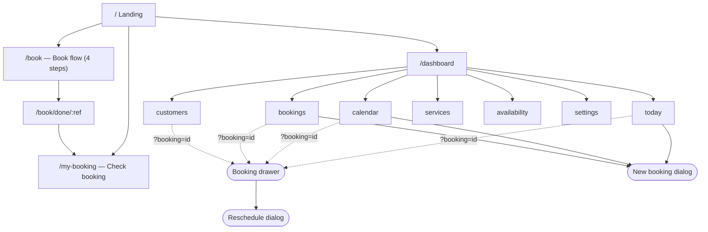
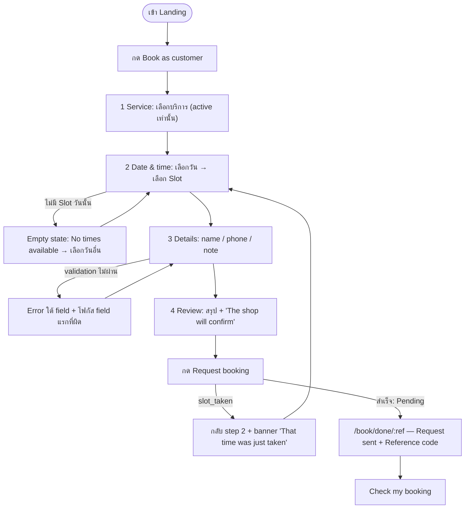
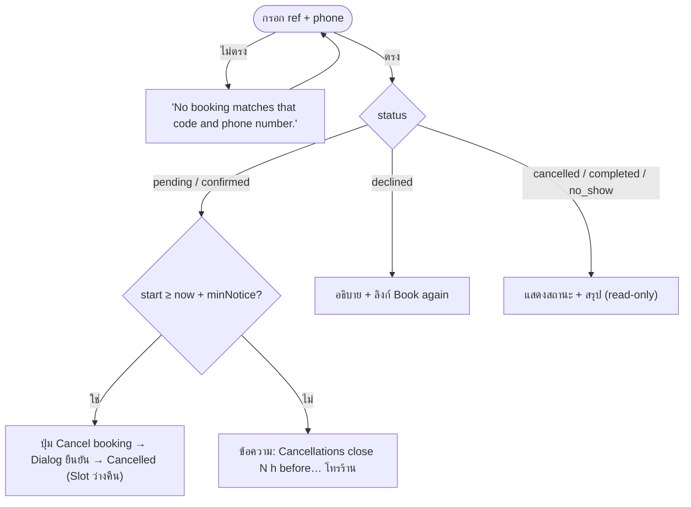
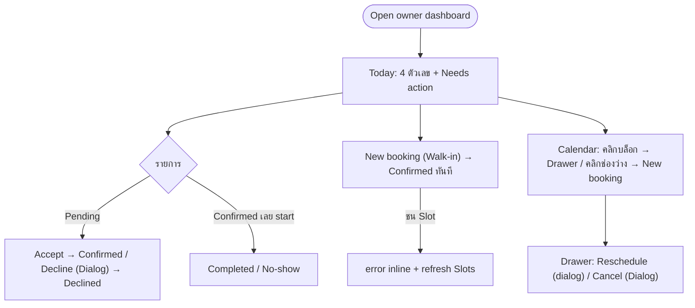
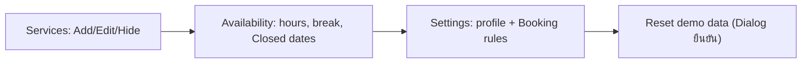
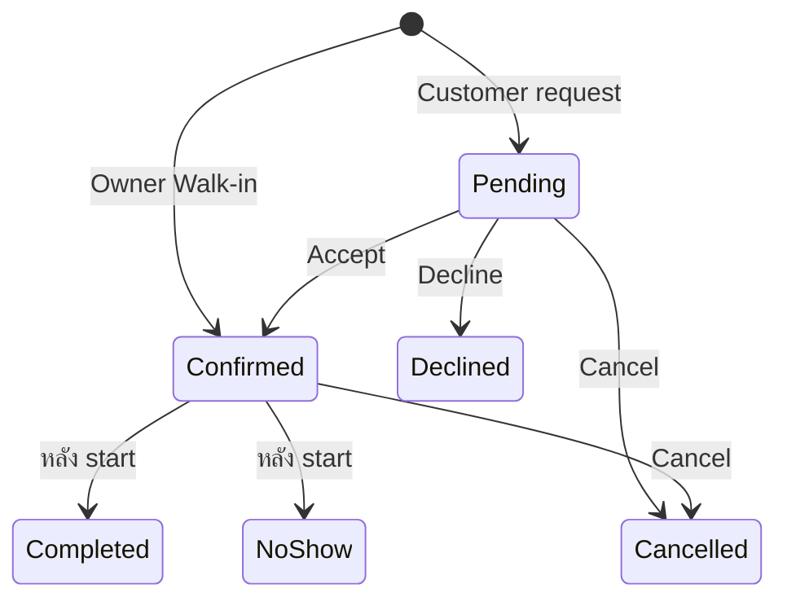

# User Flow & Sitemap

อ้างอิง: `barber-booking/spec.md` · ศัพท์ตาม `GLOSSARY.md` (Booking, Slot, Owner, Customer, ...)

## Personas

| Persona | บริบท | เป้าหมายหลัก |
|---|---|---|
| Customer | มือถือ 390px, เข้าครั้งเดียวผ่านลิงก์ | จองเวลาที่ว่างจริง ได้ Reference code ตรวจ/ยกเลิกได้ |
| Owner | จอใหญ่ที่หน้าร้าน, บางครั้งมือถือ | เห็นภาพรวมวัน, อนุมัติ request, ไม่ทับคิว |
| Portfolio viewer | ผู้ชมที่ลองกดเล่น | เข้าถึงทั้งสองฝั่งภายใน 1 คลิก |

## Sitemap

| Route | Layout | ผู้ใช้ | หมายเหตุ |
|---|---|---|---|
| `/` | Customer | ทุกคน | เลือกฝั่ง |
| `/book` | Customer | Customer | step ใน component state (ไม่มี route ต่อ step) |
| `/book/done/:ref` | Customer | Customer | ไม่เจอ ref → copy แบบ not found |
| `/my-booking?ref=` | Customer | Customer | prefill ref |
| `/dashboard/today` … `/settings` | Dashboard | Owner | 7 หน้า, nav ซ้าย (≥ lg) หรือแถบเลื่อนด้านบน |
| `?booking=<id>` บนทุกหน้า dashboard | — | Owner | Drawer เดียวใช้ทุกหน้า → deep link ได้ |
| `*` | Customer | ทุกคน | Not found + ลิงก์กลับ `/` |

## Flow 1 — Customer จองคิว

## Flow 2 — Customer ตรวจ / ยกเลิก

Status เปลี่ยนสดเมื่อ Owner กดอนุมัติ (storage event) — ไม่ต้อง refresh

## Flow 3 — Owner ประจำวัน

## Flow 4 — Owner ตั้งค่า

การเปลี่ยน Availability/Settings/Service **ไม่แตะ** Booking เดิม (Booking เก็บ snapshot duration/price)

## Booking status machine

Pending/Confirmed/Completed ถือครอง Slot · Declined/Cancelled/No-show ปล่อย Slot
